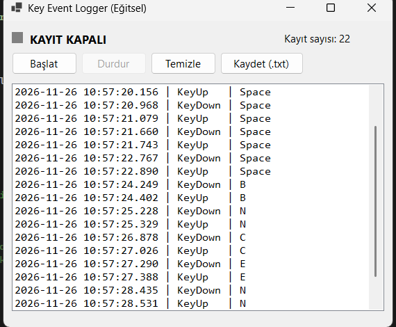
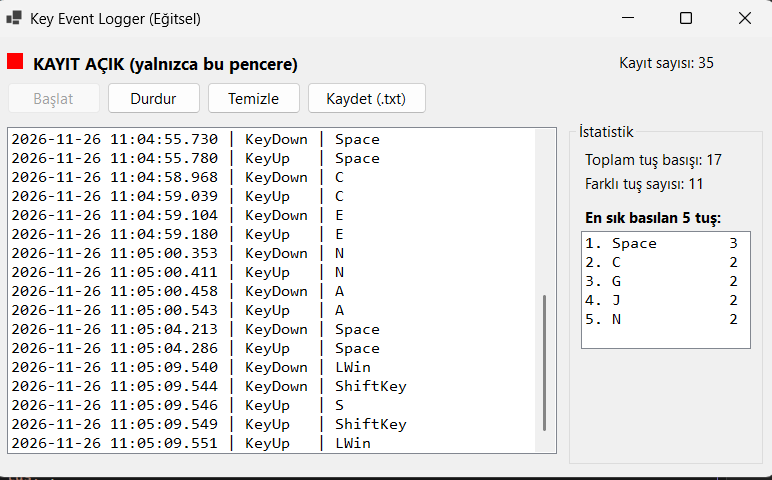

# YMH219-KeyEventLogger — Eğitsel Key Event Logger

Nesne Tabanlı Programlama (YMH 219) dersi için C# ve Windows Forms ile geliştirilmiş, klavye olaylarının nasıl yakalandığını ve işlendiğini gösteren eğitsel bir uygulama.

Uygulama **yalnızca kendi penceresi aktifken** basılan tuşları yakalar. Tuşların adını, olay türünü (KeyDown / KeyUp) ve zamanını milisaniye hassasiyetle listeler. Kullanıcı isterse kayıtları yerel bir `.txt` dosyasına kaydedebilir.

## Ekran Görüntüleri

| Kayıt listesi | İstatistik paneli |
|:---:|:---:|
|  |  |

## Kullanılan Teknolojiler

- C# / .NET 10 (`net10.0-windows`)
- Windows Forms (`KeyDown`, `KeyUp`, `KeyPreview`, `ListBox`, `SaveFileDialog`)
- Dosya işlemleri: `System.IO.File`
- LINQ (istatistik hesaplamaları)
- Harici NuGet paketi kullanılmamıştır

## Kurulum ve Çalıştırma

1. Depoyu klonlayın:
   ```
   git clone https://github.com/cenaismail/YMH219-KeyEventLogger.git
   ```
2. `YMH219-KeyEventLogger/YMH219-KeyEventLogger.slnx` dosyasını Visual Studio ile açın (.NET 10 SDK gereklidir).
3. **F5** ile çalıştırın.

## Kullanım

| Buton | İşlev |
|---|---|
| **Başlat** | Kaydı başlatır; gösterge kırmızı olur |
| **Durdur** | Kaydı durdurur; gösterge gri olur |
| **Temizle** | Ekrandaki kayıtları ve istatistikleri siler |
| **Kaydet (.txt)** | Kayıtları seçilen bir metin dosyasına yazar |

Kayıt formatı:

```
2026-11-26 10:57:24.249 | KeyDown | B
2026-11-26 10:57:24.402 | KeyUp   | B
```

## Temel Özellikler

- Basılan tuşun adı, olay türü ve zamanı listede gösterilir; liste en yeni kayda kendiliğinden kayar
- Kayıt durumu kırmızı/gri gösterge ve "KAYIT AÇIK / KAPALI" yazısıyla belirtilir
- Basılı tutulan tuşun tekrar eden KeyDown olayları tek basış olarak kaydedilir
- Butona tıklandıktan sonra odak listeye döner; böylece Space/Enter tuşları butonlara basmaz, kayda geçer
- Pencere odağı kaybedince basılı tuş bilgisi sıfırlanır; böylece tuş "takılı" kalmaz
- Kayıtlar `.txt` dosyasına UTF-8 olarak kaydedilir; dosya hataları kullanıcıya mesajla bildirilir
- **İstatistik paneli:** toplam tuş basışı, farklı tuş sayısı ve en sık basılan 5 tuş

## Proje Yapısı ve Sınıflar

```
YMH219-KeyEventLogger/
├── Program.cs          Uygulamanın giriş noktası
├── Form1.cs            Arayüz, buton olayları, KeyDown/KeyUp yakalama, istatistik paneli
├── KeyLogEntry.cs      Tek bir kayıt: zaman, tuş adı, olay türü
└── KeyLogManager.cs    Kayıt durumu (başlat/durdur), kayıt listesi, dosyaya kaydetme, istatistikler
```

**Tasarım notları**

- `KeyLogManager` arayüzden bağımsızdır; kayıt mantığı, dosya işlemi ve istatistikler bu sınıftadır.
- Yeni kayıt eklendiğinde `KeyLogManager`, `EntryAdded` olayını (event) tetikler; form bu olayı dinleyerek listeyi günceller.
- İstatistikler LINQ ile hesaplanır (`Where`, `GroupBy`, `OrderByDescending`, `Take`).

## Kapsam ve Güvenlik Sınırı

Bu uygulama gerçek bir sistem keylogger'ı **değildir**:

- Yalnızca kendi penceresi odaktayken olay yakalar (`KeyPreview`); global keyboard hook kullanılmaz.
- Gizli/arka planda çalışmaz, başlangıçta otomatik açılmaz.
- Başka uygulamalardan veri toplamaz, kayıtları ağ üzerinden göndermez.
- Kayıtlar yalnızca kullanıcı **Kaydet** butonuna basarsa ve seçtiği yere yazılır.

## Bilinen Sınırlamalar / Geliştirme Notları

- Tab gibi bazı tuşlar Windows Forms tarafından form içinde gezinme için kullanıldığından kayda geçmeyebilir.
- Win+Shift+S gibi sistem kısayollarında bazı tuş olayları işletim sistemi tarafından alındığı için eksik görünebilir.
- Kayıtları tarih/saat aralığına göre filtreleme özelliği yoktur.

## Öğrenci

- **Ad Soyad:** _AD SOYAD_
- **Öğrenci No:** _NUMARA_
